# 🚀 AWS Two-Tier Architecture — Highly Available & Scalable Web Application


A production-style **two-tier web application architecture on AWS**, deployed inside a custom VPC with a public-facing load balancer, an auto-scaling web tier, a managed database tier, HTTPS, and a custom domain.

---

## 📑 Table of Contents

- [Project Overview](#-project-overview)
- [Architecture](#-architecture)
- [AWS Services Used](#-aws-services-used)
- [Network Design](#-network-design)
- [Implementation Steps](#-implementation-steps)
- [Security Considerations](#-security-considerations)
- [Final Result](#-final-result)
- [Cleanup](#-cleanup)
- [Key Learnings](#-key-learnings)
- [Future Improvements](#-future-improvements)
- [Repository Structure](#-repository-structure)
- [Full Project Report](#-full-project-report)
- [Author](#-author)

---

## 📌 Project Overview

This project demonstrates how to design and deploy a **highly available, fault-tolerant, and scalable** two-tier architecture on AWS:

- **Presentation / Application Tier** – EC2 instances launched from a custom AMI and managed by an Auto Scaling Group, placed behind an Application Load Balancer.
- **Database Tier** – Amazon RDS running in private subnets, reachable only from the application tier.
- **Networking** – Custom VPC with public and private subnets across multiple Availability Zones, Internet Gateway, and NAT Gateway.
- **Domain & HTTPS** – SSL/TLS certificate from AWS Certificate Manager (ACM), DNS managed in Route 53, with nameservers configured at GoDaddy.

### ✨ Highlights

- Multi-AZ design for high availability
- Auto Scaling based on demand
- Database isolated in private subnets
- Least-privilege security group rules
- Custom domain with HTTPS

---

## 🏗️ Architecture

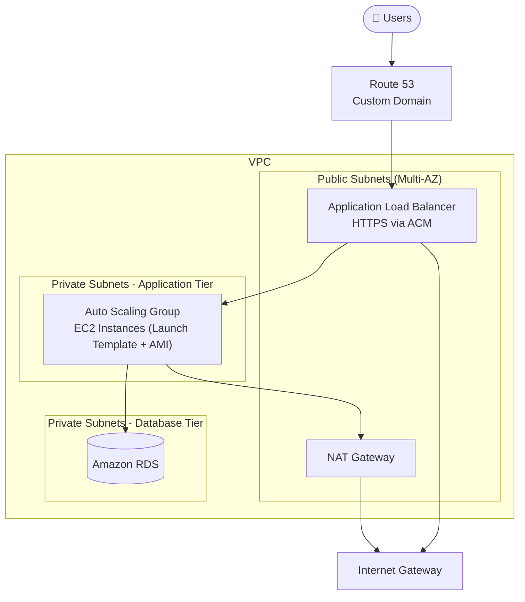

**Request flow:** User → Route 53 (DNS) → Application Load Balancer (HTTPS) → Target Group → EC2 instances in Auto Scaling Group → RDS database.

---

## 🧰 AWS Services Used

| Service                           | Purpose                                                       |
| --------------------------------- | ------------------------------------------------------------- |
| **Amazon VPC**                    | Isolated virtual network for all resources                    |
| **Subnets**                       | Public and private network segments across Availability Zones |
| **Route Tables**                  | Control traffic routing for public and private subnets        |
| **Internet Gateway**              | Internet access for public subnets                            |
| **NAT Gateway**                   | Outbound internet access for private instances                |
| **Security Groups**               | Instance-level firewall rules for each tier                   |
| **Amazon EC2**                    | Hosts the web application                                     |
| **AMI**                           | Pre-configured image used to launch identical instances       |
| **Launch Template**               | Defines how Auto Scaling launches instances                   |
| **Auto Scaling Group**            | Automatically adds/removes instances based on load            |
| **Target Group**                  | Registers instances and performs health checks                |
| **Application Load Balancer**     | Distributes traffic across instances in multiple AZs          |
| **Amazon RDS**                    | Managed relational database for the data tier                 |
| **AWS Certificate Manager (ACM)** | Free SSL/TLS certificate for HTTPS                            |
| **Amazon Route 53**               | DNS hosting and routing to the load balancer                  |
| **GoDaddy**                       | Domain registrar (nameservers pointed to Route 53)            |

---

## 🌐 Network Design

> Update the values below to match your own setup.

| Resource              | Details                              |
| --------------------- | ------------------------------------ |
| VPC CIDR              | `10.0.0.0/16`                        |
| Public Subnets        | `10.0.1.0/24`, `10.0.2.0/24` (2 AZs) |
| Private Subnets (App) | `10.0.3.0/24`, `10.0.4.0/24` (2 AZs) |
| Private Subnets (DB)  | `10.0.5.0/24`, `10.0.6.0/24` (2 AZs) |
| Region                | `us-east-1`                          |

### Security Group Rules

| Security Group | Inbound                             | Source      |
| -------------- | ----------------------------------- | ----------- |
| ALB-SG         | HTTP 80, HTTPS 443                  | `0.0.0.0/0` |
| Web-SG         | HTTP 80                             | ALB-SG only |
| DB-SG          | MySQL/Aurora 3306 (or your DB port) | Web-SG only |

---

## 🛠️ Implementation Steps

### Step 1 — Create the VPC

Created a custom VPC with a defined CIDR block to host all resources.

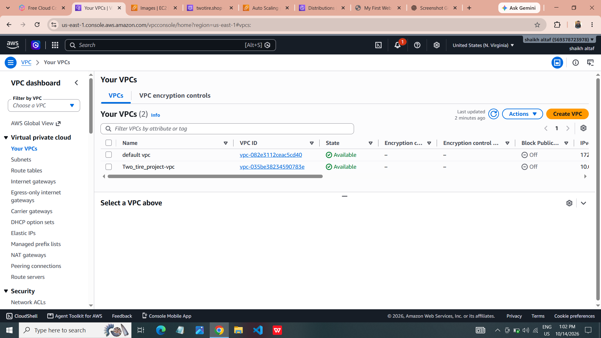

---

### Step 2 — Create Subnets

Created public and private subnets across multiple Availability Zones for high availability.

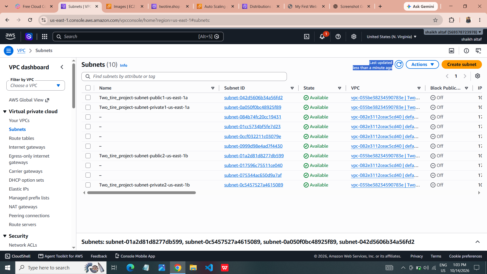

---

### Step 3 — Create Route Tables

Created separate route tables for public and private subnets and associated them with the correct subnets.

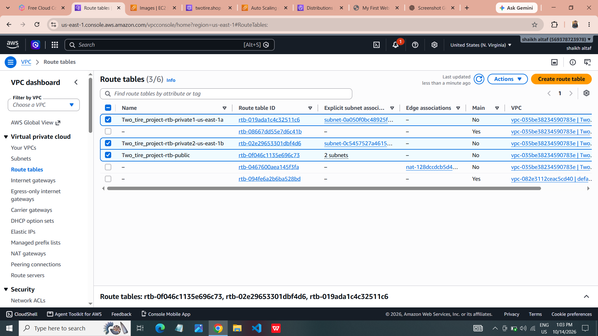

---

### Step 4 — Create and Attach Internet Gateway

Created an Internet Gateway, attached it to the VPC, and added a `0.0.0.0/0` route in the public route table.

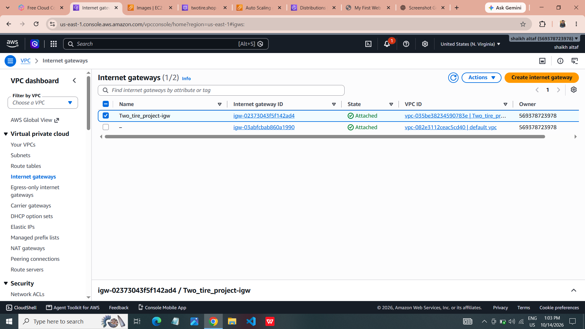

---

### Step 5 — Create NAT Gateway

Created a NAT Gateway in a public subnet so private instances can reach the internet for updates without being exposed. Added a route for it in the private route table.

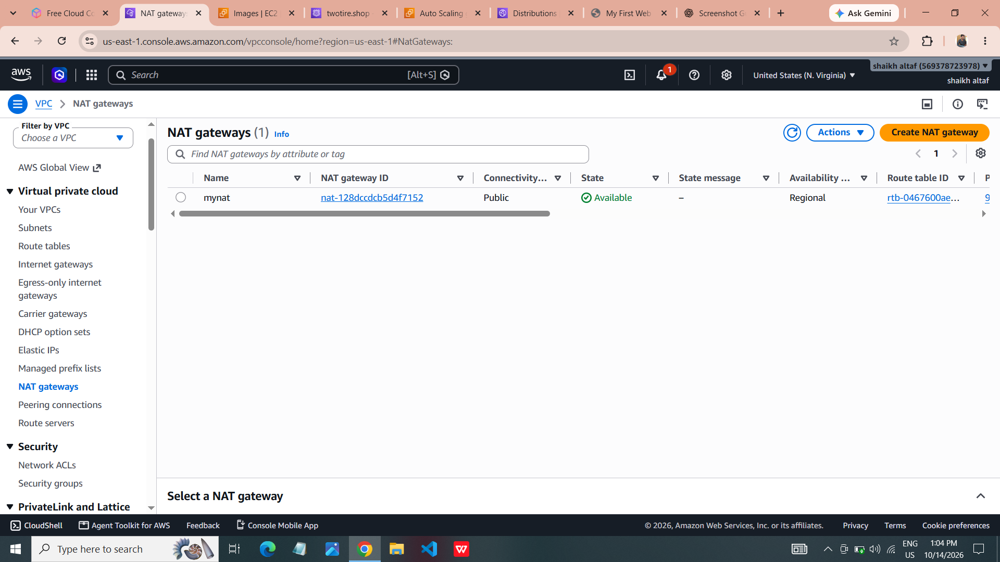

---

### Step 6 — Create Security Groups

Created security groups for the load balancer, web tier, and database tier following the principle of least privilege.

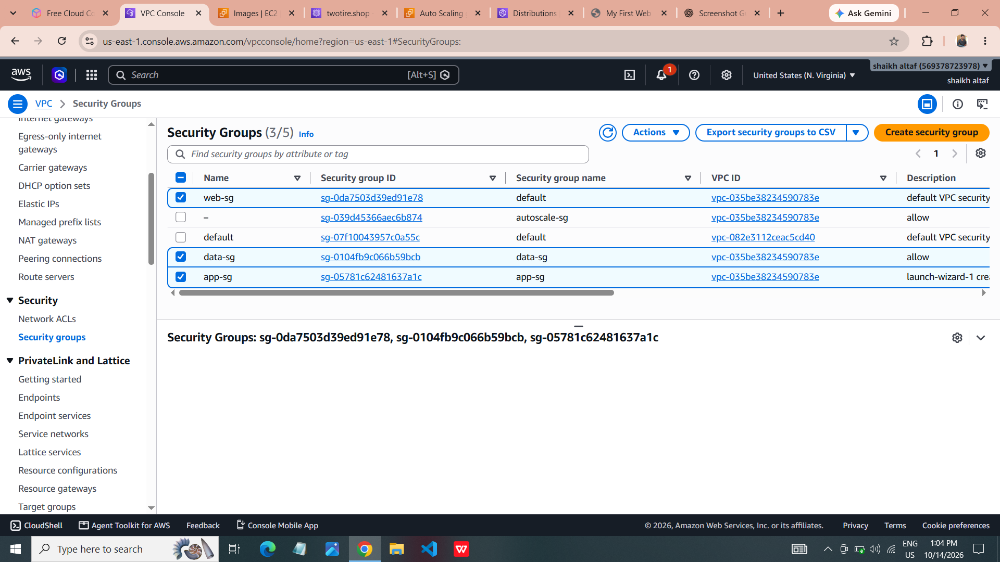

---

### Step 7 — Launch EC2 Instances

Launched an EC2 instance, installed and configured the web application and its dependencies.

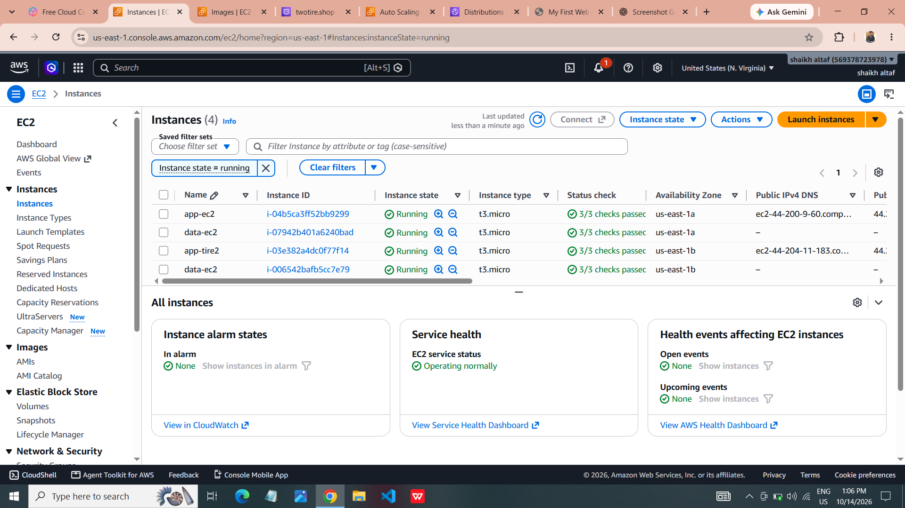

---

### Step 8 — Create Target Group

Created a target group with health checks so the load balancer only sends traffic to healthy instances.

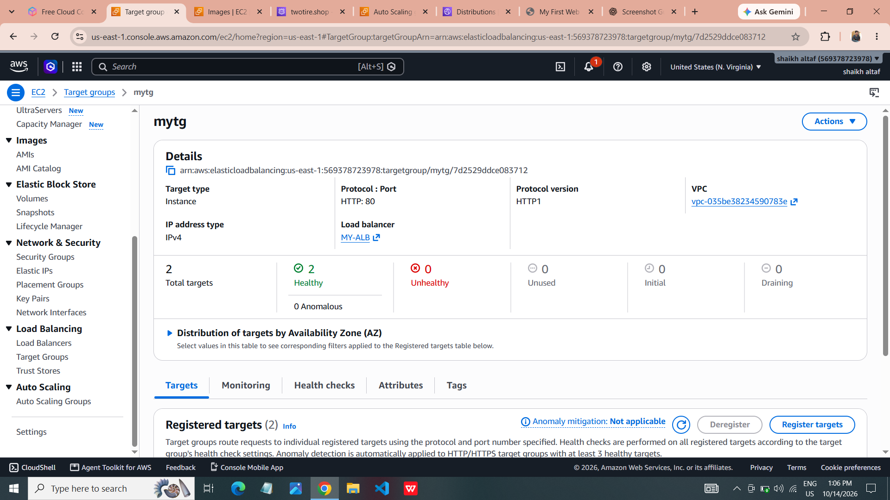

---

### Step 9 — Create Application Load Balancer

Created an internet-facing Application Load Balancer in the public subnets and configured listeners to forward traffic to the target group.

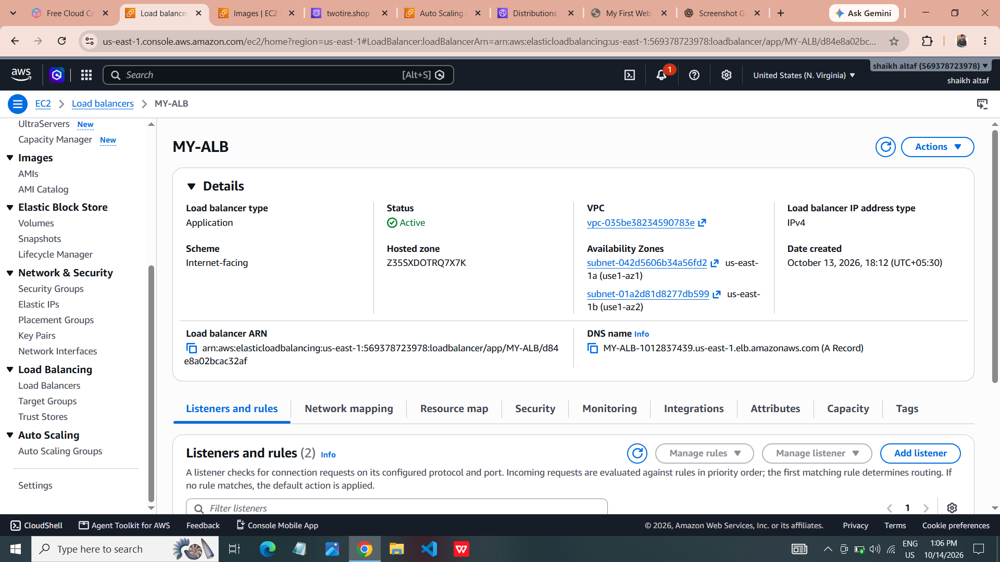

---

### Step 10 — Create RDS Database

Created an Amazon RDS instance in private subnets using a DB subnet group, accessible only from the web tier security group.

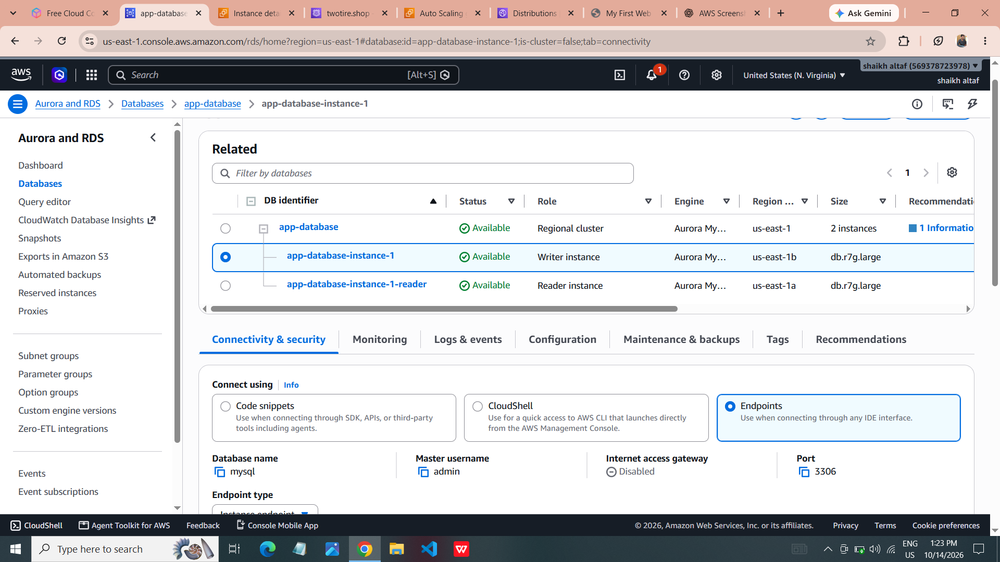

---

### Step 11 — Create AMI from EC2 Instance

Created a custom AMI from the configured EC2 instance so every new instance launches with the application pre-installed.

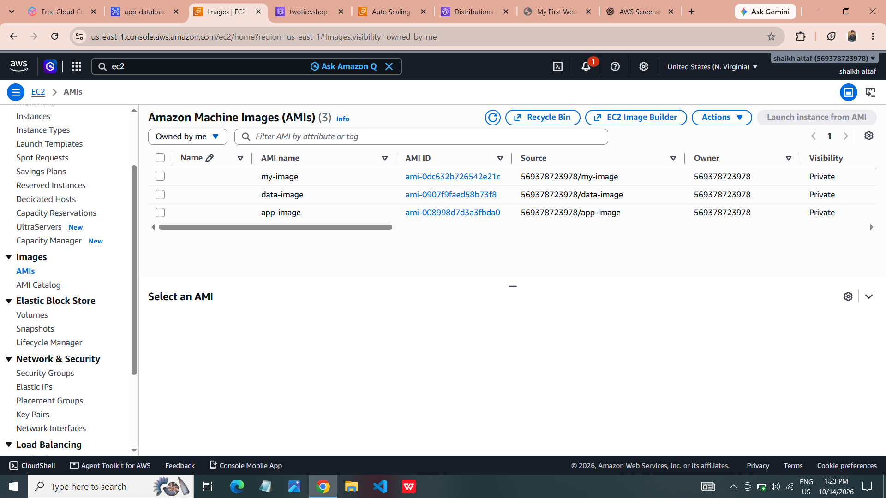

---

### Step 12 — Create Launch Template

Created a launch template using the custom AMI, instance type, key pair, and security group.

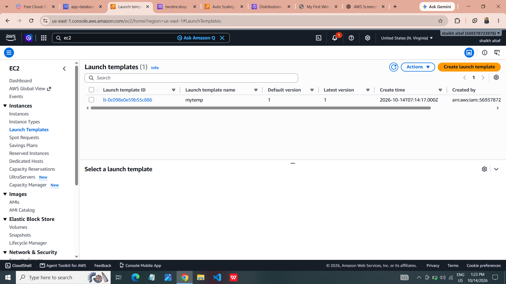

---

### Step 13 — Create Auto Scaling Group

Created an Auto Scaling Group using the launch template, attached it to the target group, and configured minimum, desired, and maximum capacity with a scaling policy.

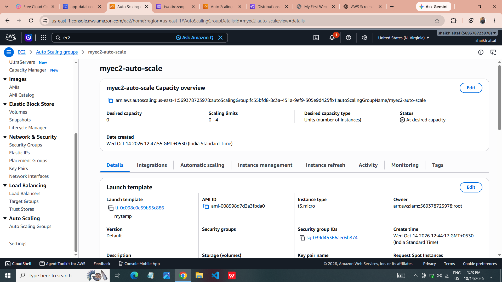

---

### Step 14 — Request SSL Certificate (ACM)

Requested a public SSL/TLS certificate in AWS Certificate Manager and validated it using DNS validation.

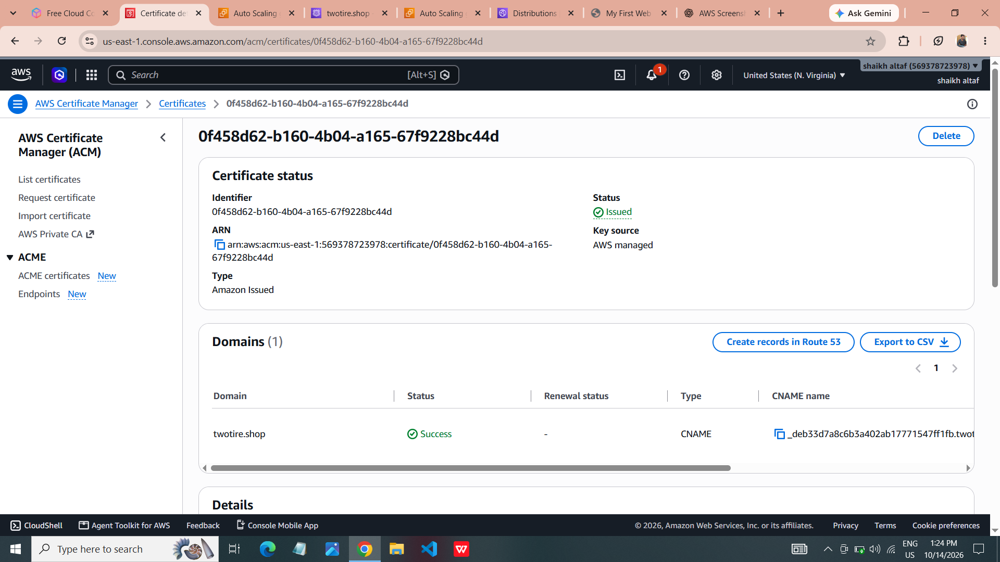

---

### Step 15 — Configure Route 53

Created a hosted zone in Route 53 and added an Alias record pointing the domain to the Application Load Balancer.

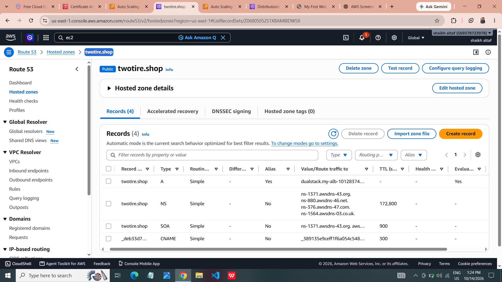

---

### Step 16 — Update Nameservers in GoDaddy

Replaced the default GoDaddy nameservers with the four Route 53 nameservers so DNS is resolved by AWS.

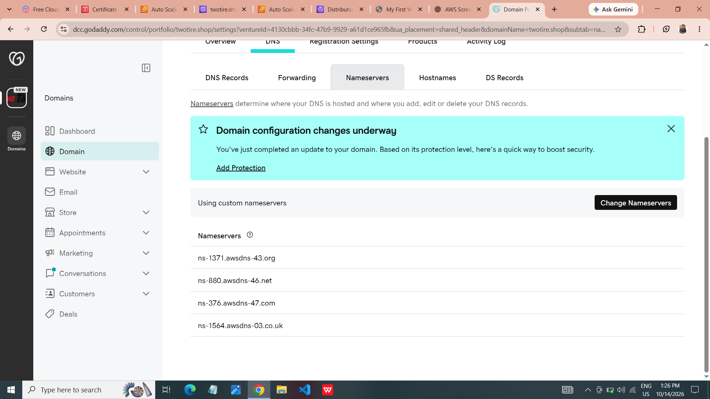

---

### Step 17 — Verify the Live Application

Accessed the application through the custom domain over HTTPS to confirm everything works end to end.

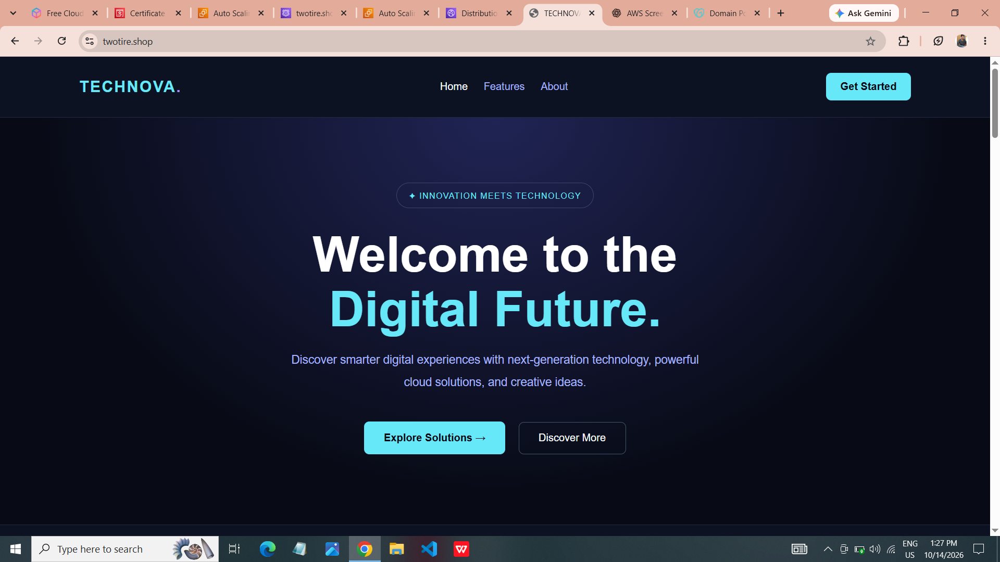

---

## 🔒 Security Considerations

- Database and application servers are placed in **private subnets** with no direct internet access.
- **Security groups** chain traffic: Internet → ALB → Web tier → Database.
- **HTTPS** enforced using an ACM certificate.
- **NAT Gateway** allows outbound-only internet access for private instances.
- No credentials or keys are stored in this repository.

---

## ✅ Final Result

The application is accessible through the custom domain over HTTPS, with traffic distributed across multiple Availability Zones and instances scaling automatically based on demand.


---

## 🧹 Cleanup

To avoid unnecessary AWS charges, delete resources in this order:

1. Auto Scaling Group
2. Load Balancer and Target Group
3. EC2 instances, Launch Template, and AMI (plus its snapshots)
4. RDS instance (and snapshots)
5. NAT Gateway and release the Elastic IP
6. Internet Gateway, subnets, route tables, security groups
7. VPC
8. Route 53 hosted zone and ACM certificate

> ⚠️ NAT Gateways, load balancers, and RDS incur hourly charges even when idle.

---

## 📚 Key Learnings

- Designing a multi-AZ VPC with public and private subnet separation
- How a NAT Gateway differs from an Internet Gateway
- Building a golden AMI and launch template for repeatable deployments
- Configuring health checks, listeners, and target groups on an ALB
- Using Auto Scaling for elasticity and self-healing
- Securing tiers with chained security groups
- Connecting a third-party domain (GoDaddy) to Route 53 and enabling HTTPS with ACM

---

## 🔮 Future Improvements

- Provision the whole stack with **Terraform** (Infrastructure as Code)
- Add **CloudWatch** alarms and dashboards
- Enable **RDS Multi-AZ** and automated backups
- Add **AWS WAF** in front of the load balancer
- Set up a **CI/CD pipeline** for application deployments

---

## 📂 Repository Structure

```
aws-two-tier-architecture/
├── README.md
├── docs/
│   └── AWS_Two_Tier_Architecture_Project_Report.pdf
└── screenshots/
    ├── 01-vpc-creation.png
    ├── 02-subnet-creation.png
    ├── 03-route-table-creation.png
    ├── 04-igw-creation.png
    ├── 05-nat-creation.png
    ├── 06-sg-creation.png
    ├── 07-launching-instances.png
    ├── 08-target-group-creation.png
    ├── 09-load-balancer-creation.png
    ├── 10-rds-creation.png
    ├── 11-ami-ec2.png
    ├── 12-launch-template-creation.png
    ├── 13-auto-scaling-creation.png
    ├── 14-acm-creation.png
    ├── 15-route-53-assosiation.png
    ├── 16-adding-nameserver-godaddy.png
    └── 17-appliction-live.png
```

---

## 📄 Full Project Report

📥 [Download the complete project report (PDF)](docs/AWS_Two_Tier_Architecture_Project_Report.pdf)

---

## 👤 Author

**SHAIKH ALTAF**
Aspiring Cloud & DevOps Engineer

- GitHub: [@your-username](https://github.com/shaikhaltaf1176-creator)
- LinkedIn: [your-linkedin](www.linkedin.com/in/shaikhaltaf786)

⭐ If you found this project helpful, consider giving it a star!
